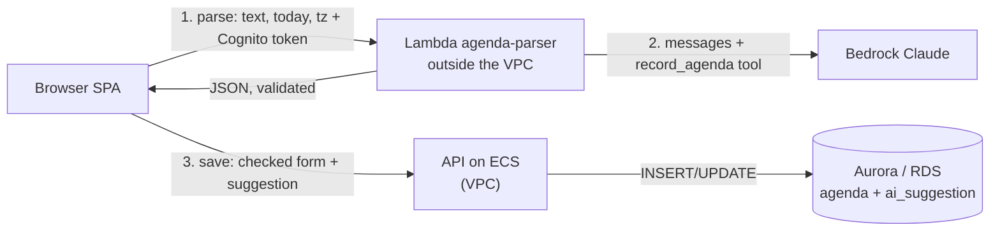

# 6. LLM agenda parsing

Status: accepted, 2026-10-29

## Context

Agendas arrive as emails, chat messages and notes, not as forms. "Paste an agenda" lets a user paste
that text, get a pre-filled agenda form, check it and save it.

Constraints:

- **No NAT, $0 when idle** (Lab 4). Anything in the VPC that must reach Bedrock needs a $7.30/month
  interface endpoint or a ~$38/month NAT.
- **Cost per call.** Every parse costs tokens, so the endpoint needs authentication, a size limit and a budget alarm.
- **Text from outside.** Pasted text may contain instructions (prompt injection). It is data, not commands.
- **Wrong answers are still a 200.** The output must be validated, and a person must confirm it.

## Decision

- **Model:** Claude Haiku 4.5 on Bedrock (`us.anthropic.claude-haiku-4-5-20251001-v1:0`) through the
  provider-neutral **Converse API**, with the tool choice forced to `record_agenda`. The model ID is
  configuration (`PARSER_MODEL`). The lab proposes the Anthropic Messages API with Opus 5.5, but on this
  account the 5.x models and the Messages endpoint (bedrock-mantle) were not available (403/404 even after
  the use-case form and the model agreement), while Converse with Haiku 4.5 worked. Haiku is also
  the cheapest option that passed the five-input test. Moving back to the Messages API is a change in one function.
- **The parser runs outside the VPC.** `spry-agenda-parser` is a Lambda function with a function URL and
  no `VpcConfig`. It gets text and returns JSON, so it needs no database. It reaches Bedrock over the
  internet, costs $0 when idle, and needs no endpoint.
- **The model never writes.** It answers by calling one tool, `record_agenda`; the output is validated
  with pydantic (one retry that shows the model its error). The browser shows a pre-filled form and the
  user saves through the existing `PUT /api/meetings/{id}/agenda`, with its own validation. The
  parser's role can only call the model and has no database access, so even an obeyed injection can only change a suggestion that
  the user is looking at.
- **Authentication:** the function URL is public, but the handler verifies the Cognito ID token
  (JWKS) and returns 401 otherwise. Text over 10,000 characters gets 413 before the model is called.
- **The suggestion is kept.** The save request carries what the model suggested, the model and the prompt
  version; the API stores it in `meetings.ai_suggestion`. Suggested vs saved is the quality signal.

## Alternatives considered

- **Call Bedrock from the API through a VPC endpoint.** Works, but adds ~$7.30/month per endpoint
  to a system that is $0 when idle, and gives the model-calling code a path to the database for no
  benefit: the parser needs no data.
- **The Claude API directly instead of Bedrock.** Needs an API key to store, rotate and keep out of
  logs; the bill leaves the AWS account (no Budgets, no cost tags); and traffic and logs are outside
  IAM/CloudTrail. Bedrock gives IAM-based access and one bill.
- **A regular-expression parser.** Free and deterministic, but handles only the formats we thought of.
  "Пн 10:00, синк ..., 1) ... — Олена, 15 хв", an English email with a signature and "by end of week"
  all need different patterns, and every new language or phrasing is new code.

## Consequences

- **Cost:** about $0.0025 per parse on Haiku 4.5 (measured: ~1,550 tokens in, ~200 out at $1 / $5 per 1M). The `agenda_parsed` log line has the real numbers.
- **Logged** as one JSON line per parse: user (`sub`), model, prompt version, input and output tokens,
  latency, cost. The pasted text is **not** logged. An AWS Budget alarms at $5 a month.
- **Bedrock down or throttled:** the parser returns 429/502, the UI shows a message and the form stays
  open for typing the agenda by hand. Saving, the meeting list and the weekly report do not depend on
  the parser and keep working.
- **Public URL:** 500 sign-ups could still run up the bill; see the answers (per-user limits, reserved
  concurrency, the budget alarm).
- **Cross-region:** the stack is in eu-central-1 (next to the ECR image Lambda needs); Bedrock is called in
  us-east-1, which adds some latency.
